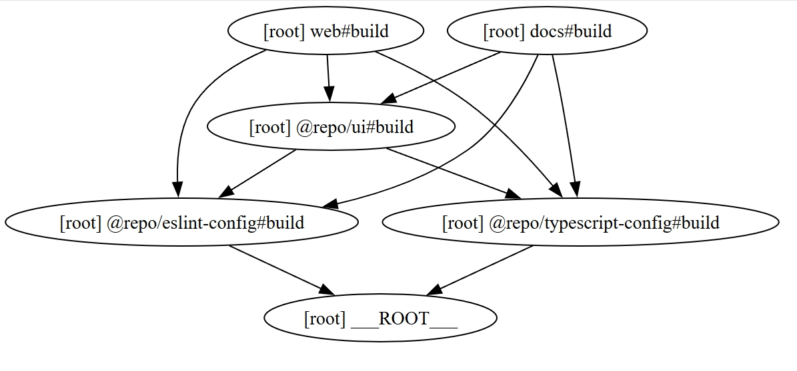
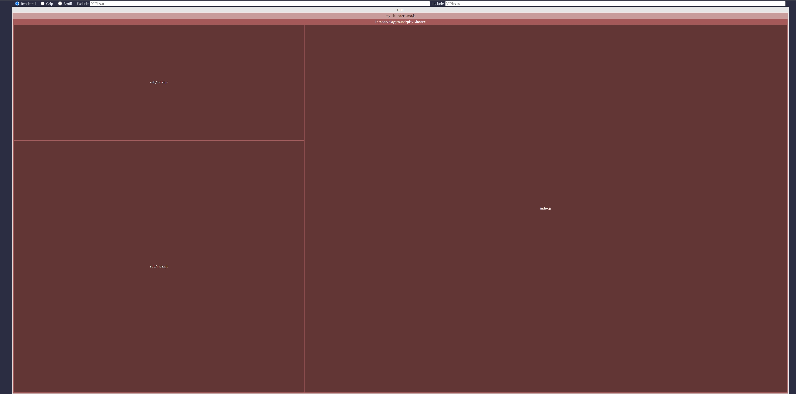

turborepo
```
$ turbo build --graph=my.svg
```




vite-bundle-visualizer
```
$ npx vite-bundle-visualizer
```



rollup options `manualChunks`
参数`id` 标识一个module（文件），以相对项目的路径或绝对路径表示。
比如`src/utils/helper.js`、`src/components/Button.js`。

每个文件路径都会被传入这个函数，相当于所有module都会经过这个函数，我们可以自行决定这个module打包到哪个chunk里。
比如module路径带`node_modules`的，都打到`vendor`:
```js
manualChunks(id) {
  if (id.includes('node_modules')) {
    // If the module is from node_modules (external libraries), bundle all of them into a separate "vendor" chunk
    return 'vendor';
  }

  // Default behavior, rollup自行决定
}
```
